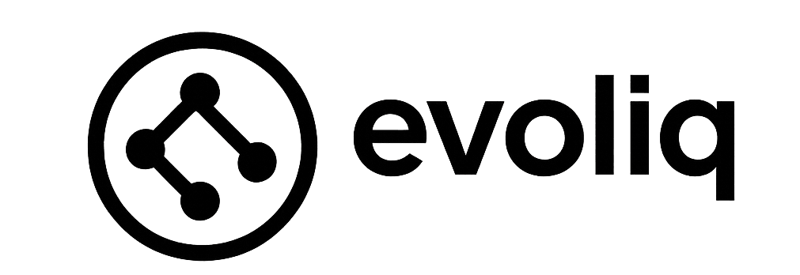

<div align="center">
  
  <h1>Unflatten W 1.0</h1>
  <p>Dokumenty do editovateľného Wordu<br>od <a href="https://www.evoliq.cz/sk">EVOLIQ s.r.o.</a></p>
  <a href="https://www.evoliq.cz/sk">
    <picture>
      <source media="(prefers-color-scheme: dark)" srcset="docs/brand/evoliq-logo-white.png">
      
    </picture>
  </a>
</div>

[English](README.md) · **Slovenčina**

Celá lokálna aplikácia Unflatten W: konverzie PDF a obrázkov, front úloh,
sťahovanie výsledných Wordov, náhľady, správa modelov a používateľské prihlásenie
s nastaveniami účtu. Model **Unflatten W Dense 1.0** sa po spustení automaticky
stiahne z Hugging Face, overí a načíta do NVIDIA GPU.

[Zdrojový kód](https://github.com/EvoliqCZ/UnflattenW_Inference_tool-) ·
[Model na Hugging Face](https://huggingface.co/Evoliq/Unflatten-W-Dense-1.0) ·
[Vydania a stiahnutie](https://github.com/EvoliqCZ/UnflattenW_Inference_tool-/releases)

## Požiadavky

- Linux, Docker Engine s Compose pluginom a NVIDIA Container Toolkit.
- NVIDIA CUDA GPU. Pre dodávanú BF16 verziu odporúčame aspoň 16 GB GPU pamäte;
  aplikácia používa existujúcu kontrolu dostupnej pamäte a vhodnosti modelu.
- Približne 11 GB pre stiahnutý model, ďalšie miesto na kontajnerové obrazy
  a vlastné dokumenty. Prvé zostavenie vyžaduje internet a môže trvať dlhšie.
- [Model](https://huggingface.co/Evoliq/Unflatten-W-Dense-1.0) je verejný.
  Na jeho stiahnutie nepotrebujete účet ani token Hugging Face. Verejná dostupnosť
  nemení podmienky osobného a komerčného použitia.

## Spustenie

Rozbaľte aplikáciu do vlastného priečinka a spustite:

```bash
./Spustit.sh
```

Pri prvom spustení sa zobrazí vysvetlenie prístupu k Docker socketu pre oddelený
PDF sandbox. Po odsúhlasení sa verejný model stiahne automaticky bez prihlásenia
na Hugging Face. Voliteľne sa použije existujúce lokálne prihlásenie alebo
`HF_TOKEN`; prípadný token sa ukladá súkromne mimo zdrojového priečinka.

Spúšťač zostaví služby, otvorí **http://127.0.0.1:8421/** a automaticky pripraví
model v GPU. V prehliadači si pri prvom použití nastavíte iba heslo a jeho potvrdenie.
Registrácia nevyžaduje prístupový ani aktivačný token. Prípravu modelu
uvidíte v úvodnom nastavení a v časti Modely. Po dosiahnutí pripraveného stavu
vložte PDF alebo obrázok a spustite konverziu. Výsledný Word stiahnete z detailu úlohy.

Pre spúšťanie kliknutím môžete jednorazovo nainštalovať lokálny odkaz:

```bash
./Instalovat-spustac.sh
```

V ponuke aplikácií potom otvorte **Unflatten W 1.0**. Spustí ten istý spúšťač.

## API a prevod bez rozhrania

Službu možno volať priamo bez prihlásenia do webovej aplikácie. Na adrese
[Swagger UI](http://127.0.0.1:8421/docs) môžete skúsiť vloženie súboru, stav úlohy
a stiahnutie Wordu. [OpenAPI JSON](http://127.0.0.1:8421/openapi.json) slúži na
integráciu. API používa vlastný Bearer token, oddelený od hesla webu aj HF tokenu.

[Návod k API](docs/API.md) obsahuje slovenský postup, nastavenia požiadavky,
curl, Swagger aj režim servera `--web-ui none`. Samostatný
[Python klient](examples/headless_client.py) používa iba štandardnú knižnicu:

```bash
cp examples/headless-request.example.json request.json
# Upravte request.json: lokálny vstup/výstup, adresu služby, prípadne model a názov.
# UNFLATTEN_API_TOKEN nastavte súkromne podľa docs/API.md.
python3 examples/headless_client.py request.json
```

Klient odošle dokument, sleduje úlohu s časovým limitom a uloží Word. Existujúci
identifikátor Word výstupu v API je `diagnostic_docx`.

## Dáta a opakované spustenie

Predvolené dáta sú v `~/.local/share/unflatten-w-app-1.0/`, mimo zdrojového
priečinka: účty, databáza úloh, výsledky a modelová cache. Voliteľný HF token na sťahovanie
je v susednom priečinku `~/.local/share/unflatten-w-app-1.0.launcher/`
v súbore s právami `0600`,
ktorý sa pripája iba workeru. Nie je súčasťou
distribučného balíka ani všeobecnej konfigurácie.

Opakovaný klik otvorí bežiacu aplikáciu bez prerušenia konverzií. Zastavené alebo
chýbajúce služby spustí s uloženou konfiguráciou bez prestavby. Účty, úlohy,
výsledky a stiahnuté váhy zostávajú zachované. Zastavenie zachová dáta:

```bash
./Spustit.sh status
./Spustit.sh logs
./Spustit.sh stop
```

Vlastný dátový priečinok a port možno zvoliť pri prvom spustení. Ďalší štart použije
uložený port; jeho zmenu aplikujte príkazom `restart`:

```bash
UNFLATTEN_APP_DATA_DIR="/cesta/k/datam" UNFLATTEN_APP_PORT=8421 ./Spustit.sh
```

Pre bezobslužné spustenie použite `UNFLATTEN_APP_NONINTERACTIVE=1` a až po
oboznámení sa s režimom sandboxu `UNFLATTEN_ACCEPT_ROOTFUL_SOCKET=1`.
Verejný model možno stiahnuť bez tokenu. Voliteľný prístup k HF sa preberá
z lokálneho prihlásenia alebo `HF_TOKEN`; token nikdy
nevkladajte do zdrojov ani návodu. Pri zmene tokenu alebo aktualizácii aplikácie
použite explicitný reštart, keď nebeží konverzia:

```bash
./Spustit.sh restart
```

Tento príkaz prestaví a znovu vytvorí služby. Už stiahnutý model sa použije z cache.
Zabudnuté heslo obnovíte v priečinku aplikácie; nové heslo zadáte skryto a staré
prihlásenia sa zrušia:

```bash
./Spustit.sh reset-password
```

Pri vlastnom dátovom priečinku použite rovnaké `UNFLATTEN_APP_DATA_DIR` aj pri obnove
hesla. Zdrojový a dátový priečinok môžu obsahovať medzery. Znaky `\`, `"`, `$`, `%`,
`:`, `,` a riadiace znaky nie sú podporované; spúšťač ich odmietne pred zápisom.

## Model a rozsah

Katalóg používa overený modelový commit
`9ebf7df1d6b01ae5d3a396f379fe454378a38ae7` a hash jeho manifestu. Nedôjde
k automatickému prechodu na inú revíziu, model alebo CPU. Používa sa natívny
engine, BF16 a DeepStack. Nedostupná GPU alebo chýbajúci prístup k modelu
musí byť vyriešený pred konverziou. Stiahnuté váhy a pripravený model v GPU sú
samostatné stavy: pri chybe načítania sa použije opakovanie „Načítať na GPU“,
ktoré znovu nesťahuje overené váhy. Studený štart preverí dostupnú pamäť aj pri
uloženom predvolenom modeli. Na integrovanej CUDA GPU (DGX Spark) sa podľa
[odporúčania NVIDIA](https://nvidia.custhelp.com/app/answers/detail/a_id/5728) zohľadní
aj systémom uvoľniteľná zdieľaná RAM; swap sa do odhadu nepripočítava.

Unflatten W obnovuje editovateľné dokumenty Word z PDF a obrázkov. Dokumenty sa
spracúvajú lokálne. PDF parser zostáva v samostatnom obmedzenom kontajneri.

## Licencia a pôvod

Pôvodné časti EVOLIQ sú pod [EVOLIQ Personal Use and Commercial License 1.0](LICENSE):
osobné nekomerčné použitie zadarmo, komerčné a firemné použitie na základe platenej
dohody. Kontakt: [EVOLIQ s.r.o.](https://www.evoliq.cz/sk).
Komponenty tretích strán si zachovávajú svoje licencie; pozrite NOTICE,
LICENSE-APACHE-2.0 a upozornenia vo `vendor/`.

`source-origin.json` zaznamenáva pôvod zdrojovej kópie. Táto distribúcia vznikla
z existujúcej aplikácie vrátane jej rozpracovaných opráv; nie je označená ako čistý
pôvodný git commit. Zdrojové váhy sa do balíka aplikácie nepribaľujú.

Vo firemnej sieti spúšťač preberá štandardné premenné `HTTP_PROXY`, `HTTPS_PROXY`
a `NO_PROXY` pre zostavenie a sťahovanie modelu. Ich hodnoty sa nezapisujú do zdrojov.

## Overenie tejto prípravy

Pôvodná príprava overila stiahnutie modelu do prázdnej cache. Po opravách auditu
prešlo všetkých 1 973 backendových testov (vrátane pomalých a doplnkových testov skladača) a 646 testov rozhrania.
Finálne uzamknuté obrazy boli znovu vyskúšané na Linuxe ARM64 na DGX Spark:
načítanie do GPU, skutočný prevod dvojstranového PDF na Word, opakované otvorenie
počas úlohy, reštart so zachovaním dát, opakovanie obrázkového uploadu, zrušenie
úlohy, vymazanie a obnova hesla. Testovací projekt sa po overení zastavil.

Presný rozsah overenia a aktuálny výsledok kontroly závislostí sú v
`distribution-verification.json`. Kompletná sada testov bežala v lokálnom testovacom
prostredí; finálne obrazy dostali uvedené prevádzkové skúšky. Samostatný lokálny FP8 variant bol overený aj na RTX 4070 SUPER 12 GB (AMD64);
štandardná distribúcia používa BF16. Ukážka nie je hodnotením kvality modelu na reálnych dokumentoch.


## Jazyk a zdrojový kód

V päte každej obrazovky, aj pred prihlásením, je voľba **SK / EN**. Voľba sa
ukladá v prehliadači. Bez uloženej voľby sa pri slovenčine prehliadača použije
slovenčina, pri ostatných jazykoch angličtina. Obsah vašich dokumentov sa tým nemení.
Spúšťač používa jazyk systému; vynútiť ho možno cez
`UNFLATTEN_APP_LANG=sk ./Spustit.sh` alebo `UNFLATTEN_APP_LANG=en ./Start.sh`.
Anglické názvy `Start.sh` a `Install-launcher.sh` volajú rovnaké spúšťanie a používajú
rovnaké dáta ako slovenské názvy.

Zdrojový kód nástroja: [EvoliqCZ/UnflattenW_Inference_tool-](https://github.com/EvoliqCZ/UnflattenW_Inference_tool-).
Nástroj aj model sú verejne dostupné; komerčné použitie vyžaduje platenú licenčnú dohodu.
Podrobnosti vydania, evaluácie a obmedzení sú v [prehľade vydania](docs/RELEASE.md).
